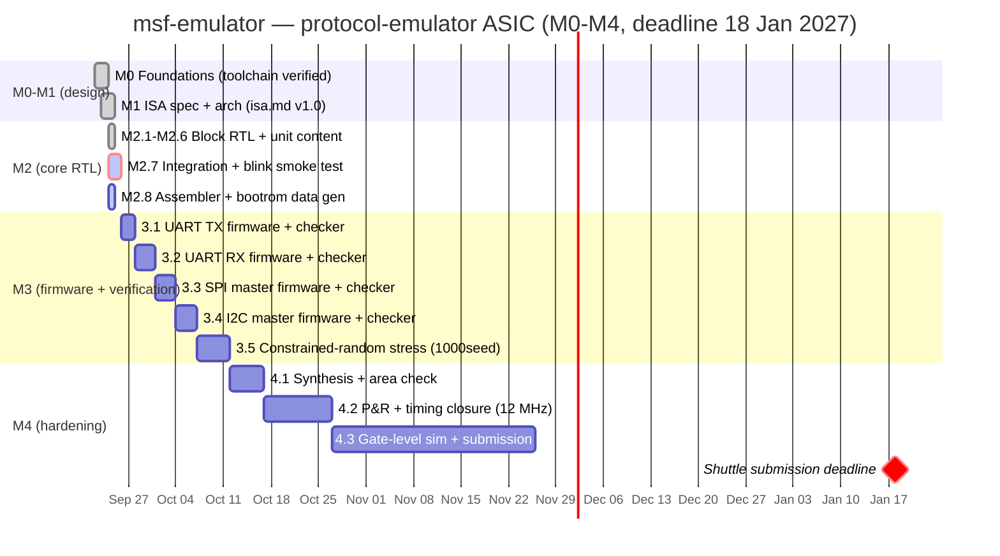

# msf-emulator — Progress Tracker

> Private working doc (`docs/sam/`). Mirrors the plan in `PLAN.md` and reports the
> **actual** state against repo evidence (files present, test suite output), updated
> **2026-09-24**.

- Design: Tiny Tapeout protocol-emulator ASIC — hybrid RISC core + serial shift
  datapath (F1.5 footprint, 512-word IMEM, ~8 K cells, 12 MHz, IHP 130 nm).
- **Shuttle submission deadline: 2027-01-18.**
- Build/test: `. .\setup-env.ps1` then `cd test; make -B`.

## Gantt — plan vs. reality

Legend: `done` = complete with gate passed · `active` = in progress today ·
future bars are **target durations**, not commitments — M3/M4 dates are estimates
to fit the 2027-01-18 deadline with headroom.

## Milestone status

| Milestone | Scope | Status | Progress | Evidence / notes |
|---|---|---|---:|---|
| M0 Foundations | iverilog 12, cocotb 2.0.1, ezwinports make, MSYS2 sh | ✅ Done | 100% | Toolchain verified; template test passed at M0. |
| M1 ISA & arch | `isa.md` v1.0, block diagram, cell budget, firmware plan | ✅ Done | 100% | `docs/sam/isa.md` v1.0 closed 24 Sep; `architecture-research.md` (~8 K cells); `bootloader.s` (UART-RX ROM bootloader drafted). |
| M2 Core RTL | `src/*.v` blocks, integration, blink smoke, assembler | 🟡 In progress | ~85% | All 7 modules written (below); **M2.7 gate not green** — see "Blocking items". |
| M3 Firmware | UART TX/RX, SPI, I2C, stress, (stretch) USB/Eth | ⬜ Not started | 0% | Gated on M2.7. |
| M4 Hardening | Synthesis, P&R @12 MHz, GLSIM, submission | ⬜ Not started | 0% | Deadline 2027-01-18. |

### M2 detail (per `PLAN.md` step)

| Step | Status | Evidence | Gate state |
|---|---|---|---|
| 2.1 Top wrapper | ✅ | `src/tt_um_msf.v` (96 L) — pins, `ui/uiO/uio` wiring, `_unused` | ⚠️ Compiles blocked: bootrom data file missing (see below) |
| 2.2 Regfile | ✅ | `tt_um_msf_regfile.v` (29 L) — 8×16, 2R/1W, async reset | Unit test not yet in `test_core` (folded into M2.7) |
| 2.3 ALU + flags | ✅ | `tt_um_msf_alu.v` (40 L) — ADD/SUB/AND/OR/XOR/SHL/SHR/INCR/DECR/MOV, Z/N | Same as above |
| 2.4 Fetch/decode/execute | ✅ | `tt_um_msf_ctrl.v` (249 L) — 32 opcodes, 1-cycle registered IMEM fetch, `WAIT_EDGE`/`WAIT_CMP` stalls + 16-bit HW timeout, shift datapath (OSR, bit-7 serial), 16-bit cycle counter, IMEM write (auto-inc 128..511) | Same as above |
| 2.5 IMEM SRAM | ✅ | `tt_um_msf_sram.v` (31 L) — 384×16 (IMEM 128..511), registered read (macro-behaviour) | Same as above |
| 2.6 Pin I/O | ✅ | `tt_um_msf_pio.v` (42 L) — cycle-accurate output stage, OE set/clear, serial pin on bit 7, status byte | Same as above |
| 2.7 Integrate + blink smoke | 🟡 | `test/tb.v` + cocotb harness present; **`test/test.py` is still the upstream template** (`test_project`, asserts `uo_out==50`) and Makefile expects module `test_core` | ❌ Not passing |
| 2.8 Assembler | ✅ | `test/assembler.py` (159 L) — ISA assembler, `crc8`, ROM-data generator; `bootloader.s` (≈100 insns UART-RX bootloader) | ⚠️ Generated file `src/tt_um_msf_bootrom_data.v` not in tree → build fails |
| (extra) Boot ROM | ✅ | `tt_um_msf_bootrom.v` (20 L) — 128×16, registered read, data `include` | Data file missing |

## Blocking items (close M2.7 / green `make -B`)

1. **Generate bootrom data** — `python test/assembler.py` must run so
   `src/tt_um_msf_bootrom_data.v` exists; iverilog currently fails with
   `Include file tt_um_msf_bootrom_data.v not found`.
2. **Test module mismatch** — `test/Makefile` has `COCOTB_TEST_MODULES = test_core`
   but `test.py` defines `test_project`. Rename the file/test to `test_core`
   (cocotb loads modules by name).
3. **Write the real blink smoke test** — blink firmware assembled in Python,
   loaded into SRAM (via `PIN_W`/debug path or by pre-loading memory), observe
   `uio_out` pattern; gate = pattern seen in `gtkwave tb.fst tb.gtkw`.
4. **Clean iverilog warnings** — `tt_um_msf_ctrl.v` sized-hex constants truncated
   to 4 bits (`4'h11`-style op comparisons); rewrite case items with 8-bit masks
   (`8'h51` etc.) so the build is warning-clean.

## Up-to-now log

- 2026-09-23 — M0 complete (toolchain); clock target 12 MHz decided.
- 2026-09-24 — M1 closed: `isa.md` v1.0 (F1.5/S-RAM-macro/shift-datapath
  decisions locked); all M2 block RTL written; assembler + bootrom-style
  firmware drafted; `make -B` passing compile blocked only by generated data
  file (item 1 above).
- 2026-09-30 — **GDS rendered in GDS3D 1.8** (18.3 MB, 204 671 boundaries,
  66 074 structures, ~948 MB VRAM, 893 VBOs). Topcell `tt_um_msf` auto-picked.
  New process file `techfiles/tt_um_msf.txt` created (20 PDK layers).
  **Known issues** (see `docs/shared/drc-analysis.md`):
  - Design is **31K cells vs 24K budget** → P&R squeezed logic → unresolved
    DRC (shorts/spacing) → routing stubs visible in 3D.
  - SRAM macro (402.61 × 219.77 µm, R90) looks "floated" due to visual
    contrast + missing TopMetal PDN rendering + Metal4 power halo not visible.
  - "Wires to nothing" = DRC stubs + unlisted GDS layers (IO pads, layer 63, 189).
