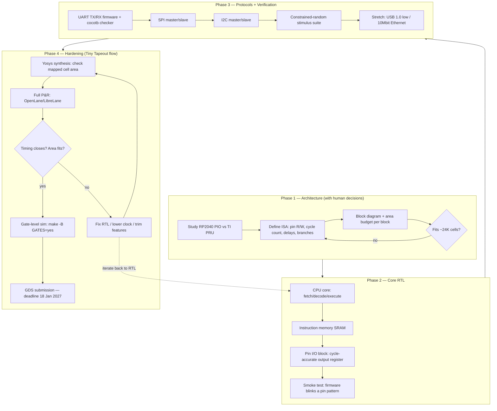
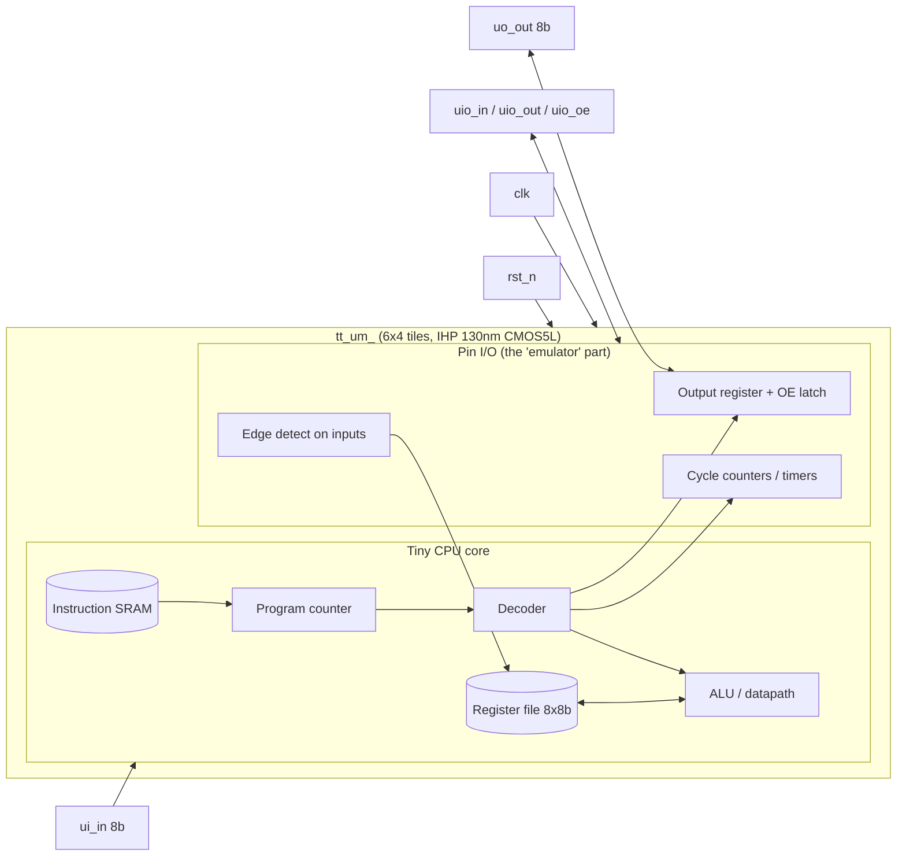
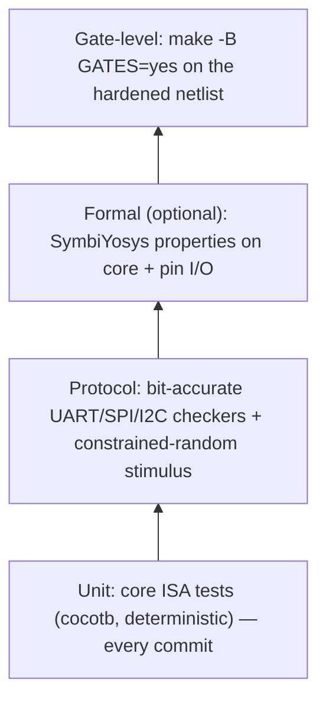

# Protocol Emulator ASIC — Project Guide (private, not in git)

> Full roadmap: what to build, what languages/tools, how to test, and the iterative loop.
> Companion to `PLAN.md` in the repo (also private).

---

## 1. The big picture (iterative process)

**Key idea:** every phase ends with a *measurable* gate (test passes, area number, timing report). Never move on with an open question.

---

## 2. Proposed chip architecture

- **Firmware** (stored in instruction SRAM) implements UART/SPI/I2C — the hardware only provides: read pin, write pin, count cycles, branch.
- `uio_oe` = 1 → pin is an output driven by `uio_out`; `uio_oe` = 0 → pin is an input sampled from `uio_in`.
- Cycle counters give the firmware *exact* timing (e.g. "hold this pin for N clock cycles") — that's what makes protocols possible.

---

## 3. Languages you'll need

| Language | Where | Why |
|---|---|---|
| **Verilog** | `src/*.v` | The RTL. Tiny Tapeout IHP template is Verilog-based. Synthesizable only. |
| **Python** | `test/test.py`, firmware tooling | cocotb testbenches, protocol checkers, and a tiny assembler that turns firmware into instruction-SRAM hex |
| **C (optional)** | reference models | Bit-accurate UART/SPI/I2C reference models to cross-check cocotb checkers |
| **Tcl (optional)** | EDA scripts | Only if you script Yosys/OpenLane flows directly; Tiny Tapeout mostly wraps this for you |
| **YAML** | `info.yaml` | Project metadata: tile size, top module, pinout |

You do **not** need SystemVerilog, VHDL, or OCaml/Hardcaml (Jane Street uses Hardcaml internally, but the competition explicitly welcomes any language).

---

## 4. Testing process & software

### 4.1 Toolchain (already installed & verified on your machine)

| Tool | Role |
|---|---|
| **Icarus Verilog 12** (`iverilog`/`vvp`) | Compiles + runs RTL simulation |
| **cocotb 2.0.1** | Python-based testbench framework driving the DUT |
| **ezwinports make + MSYS2 sh** | Runs cocotb's makefiles on Windows |
| **GTKWave / Surfer** | View `tb.fst` waveforms |
| **Yosys** | Synthesis → mapped cell count (area budget check) |
| **SymbiYosys (optional)** | Formal verification (property checking — scores well for "novel verification") |
| **Tiny Tapeout flow (LibreLane/OpenLane)** | RTL → GDS via GitHub Actions (already in `.github/workflows`) |

### 4.2 Test pyramid (bottom = fast/cheap, top = slow/expensive)

- **Run after every RTL change:** `cd test; make -B` (RTL sim, ~seconds).
- **Protocol checkers** live in Python: they reconstruct the expected bit stream and compare against observed pin transitions — this is the "verification story" the competition scores.
- **Constrained-random:** randomize baud rates, word lengths, back-to-back frames, idle gaps; the checker validates each.
- **FPGA (your friend's):** port the same cocotb tests to a real board for timing sanity before ASIC.

### 4.3 Area & timing loop (the part that kills most submissions)

1. `yosys -p "read_verilog src/*.v; synth -top tt_um_<you>"` → read mapped cell count.
2. Budget: **~24K cells max**, leave ~15–20% headroom for clock-tree buffers + routing.
3. Run the full Tiny Tapeout P&R (GitHub Action) → check timing report at your chosen clock.
4. If it fails: lower clock, trim features, or restructure RTL → repeat.

---

## 5. Concrete task list (in order)

1. **Decide architecture** (1–2 sessions with you): PIO-style vs PRU-style, register count, instruction width, SRAM size, clock target.
2. **Write ISA spec** (a doc, not code) — opcodes, addressing, pin ops, cycle semantics.
3. **Core RTL** + smoke test (blink pattern via firmware).
4. **Tiny assembler** (Python) → instruction SRAM init.
5. **UART** firmware + cocotb checker → **SPI** → **I2C** (same pattern each time).
6. **Constrained-random suite** + (optional) formal properties.
7. **Synthesis + area check** → fix until under budget.
8. **Full P&R** → timing closure.
9. **Gate-level sim** → GDS.
10. **Open-source polish:** README, docs, submission form (deadline **18 Jan 2027**).

---

## 6. Risks & mitigations

| Risk | Mitigation |
|---|---|
| Core too big for 24K cells | Area-estimate each block *before* writing RTL; SRAM for instructions, not FFs |
| Timing doesn't close | Pick a modest clock (e.g. 12–24 MHz) early; USB 1.0 low needs ~12 MHz+ |
| Firmware timing bugs | Cycle-accurate counters in HW; bit-accurate Python checkers |
| Verification looks thin | Constrained-random + formal properties = explicit scoring bonus |
| Deadline pressure | UART working by ~Oct, all 3 protocols by ~Nov, hardening Dec–Jan |
